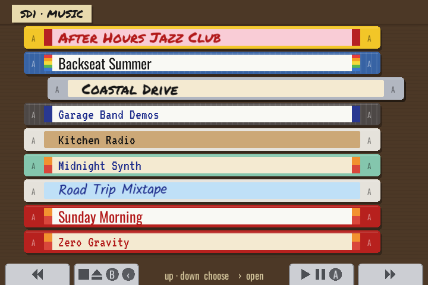
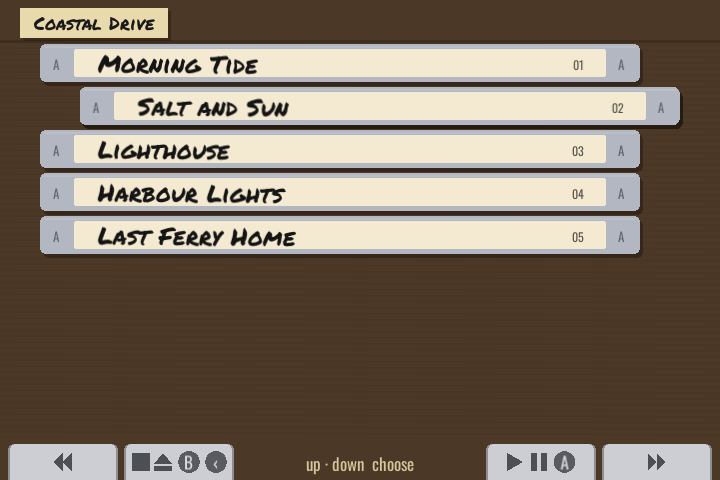
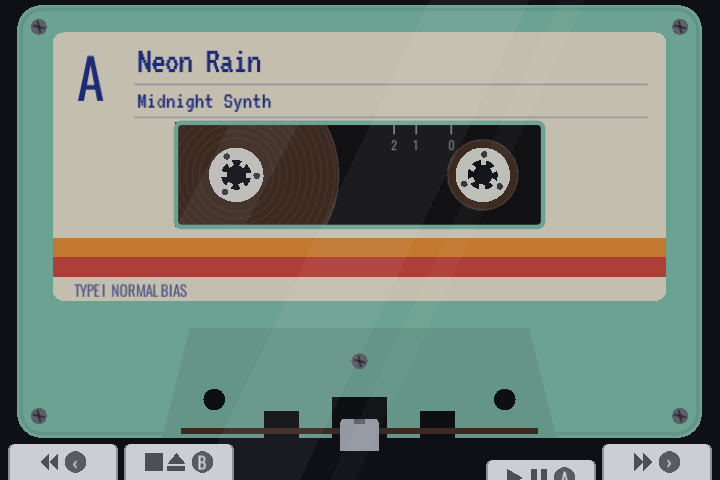
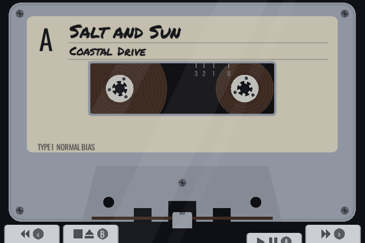

# Retro Cassette Player

A music player for [muOS](https://muos.dev) handhelds that shows a cassette
inside a closed portable player. The handheld's own screen bezel acts as the
player body, so the cassette fills the screen. The transport keys sit on the bottom
edge, right above the shoulder buttons. The layout is made for the Anbernic RG34XXSP
(720×480); other screens get black bars. There are no on-screen icons or readouts. You
can tell what the player is doing the way you would with a real one: from the
keys that are pressed down, the turning reels, how much tape is on each reel
and the play head against the tape.

| The box of tapes | Inside an album |
| --- | --- |
|  |  |
| **Playing Midnight Synth** | **Playing a song from Coastal Drive** |
|  |  |

Each tape's shell, label paper, stripes, handwriting and ink come from its
album's name, and the cassette in the player matches its spine in the box.

Built with [LÖVE](https://love2d.org) 11.x (Lua). The app's folder and package
are named `RetroCassette`, so updates install over the earlier version.

## How it works

- **A folder is one side of a tape.** Its songs are recorded one after another
  with a few seconds of blank tape between them. The reels show how far you are
  through the whole album, and the minute marks on the cassette window show the
  time: read it where the edge of the right-hand tape pack sits.
- **The library is a box of tapes.** Each album folder, and each song inside
  one, is a cassette lying in a stack with its spine facing you.
- **Every tape has its own look**, chosen from its folder's name: shell colour,
  label paper, stripes, the handwriting or typeface of the title and the ink.
  The cassette in the player looks exactly like its spine in the box.
- **The label** shows the song under the head and the folder (album or artist) name.
- **The keys stay down** like real ones. PLAY stays down while playing, sits
  half-way while paused, and FF or REW stays down while winding. They pop up
  with a clunk at the end of the tape.
- **Volume** is the device's own volume buttons.
- **A long box shows where you are:** the box label names the letter you're
  in and a pencil note says "40 of 87", and A–Z divider cards stand between
  the albums where each letter starts.
- **Two cards** show up as **SD1 · MUSIC** and **SD2 · MUSIC**.
- **Loading:** song lengths are read from file headers, so even hour-long
  mixes don't have to be loaded to measure them. A song is opened straight
  from the card; one too big for the free memory is skipped like an
  unreadable file instead of crashing the app.
- **Pocket mode:** after 30 seconds without a button press the screen goes
  dark; music keeps playing. Any button wakes it (that press does nothing else).

MP3, OGG, FLAC and WAV are supported.

## Controls

The four keys along the bottom of the screen are the shoulder buttons, in the
order they sit on the RG34XXSP hinge (L1 L2 on the left, R2 R1 on the right):

| Button | Key | Stopped | Playing |
| --- | --- | --- | --- |
| L1 | REW | Rewinds until STOP or the start of the tape | Tap: back to the start of this song (or the previous one in its first 3 s). Hold: review, the tape runs back muted |
| L2 | STOP/EJECT | Opens the lid and goes back to the library | Stops; the tape stays where it is |
| R2 | PLAY/PAUSE | Plays | Pauses; press again to carry on |
| R1 | FF | Fast-forwards until STOP or the end of the tape | Tap: wind to the next song (music sensor). Hold: cue, the tape plays fast and high-pitched |

A works as PLAY and B as STOP; the keys show these twins as round badges. D-pad left / right jumps straight to the
previous / next song (with a short whir of the reels), while L1 / R1 stay
real REW / FF.

The library shows the same keys along the bottom, with each key's twin
printed on it:

| Button | Twin | Library |
| --- | --- | --- |
| D-pad up/down | | Previous / next tape |
| L1 / R1 | | Among albums: jump to the previous / next letter. Among songs: a pile of tapes back / forward |
| R2 (PLAY) | A | Put the tape in and play: an album from its first song, a song from that song |
| L2 (STOP) | B, D-pad left | Back up a folder |
| D-pad right | | Open an album to see its songs |

Select + Start or the Menu button quits.

On a desktop: arrows, Z = A, X = B, A/S/D/F = L1/L2/R2/R1, Tab = Select,
Space = Start, Esc = quit.

## Where to put music

Put a `MUSIC` folder at the top of an SD card, with one folder per album. The
app asks muOS where the SD cards are mounted and shows each card's `MUSIC`
folder that exists (usually `/mnt/mmc/MUSIC` on SD1 and `/mnt/sdcard/MUSIC` on SD2; with both, the top level shows them as **SD1 · MUSIC** and **SD2 · MUSIC**).

> **Switch the device off before taking an SD card out** to add music. muOS
> sets up its storage when it starts, so a card pulled out and put back while
> the device is on isn't picked up again, and Retro Cassette Player (which is
> installed on the card) won't start until you restart the device.

Set `RC_MUSIC_DIR` to use a different folder.

## Install on a device

Made for muOS 2606 (Andromeda).

1. Download `RetroCassette-<version>.muxapp` from the [Releases](https://github.com/alesavin/muos-retro-cassette-player/releases) page, or build it with `scripts/package.sh <version>`.
2. Copy the `.muxapp` to the `ARCHIVE` folder at the top of the SD card
   (`SD1/ARCHIVE/`) and install it with Applications → Archive Manager.
3. Start **Retro Cassette Player** from the Applications menu.

The app runs on the LÖVE runtime that muOS ships with its built-in 2048 Plus
app, so nothing extra needs installing. A runtime copied into
`RetroCassette/bin/` takes priority (see [RetroCassette/bin/README.md](RetroCassette/bin/README.md)).
While the app is open the device won't go to sleep, so music keeps playing.
Output from the app goes to `RetroCassette/data/log.txt`, and settings are kept
in `RetroCassette/data/`.

> **Not yet tested on hardware.** The launcher and archive layout follow the
> muOS 2606 source (its own LÖVE app and archive installer), but they still need
> to be checked on a real device. L2/R2 are read as analog triggers, and A/B can come out swapped
> depending on the device's controller mapping.

## Develop on a desktop

```sh
RC_MUSIC_DIR=~/Music love RetroCassette/game
```

Checks:

```sh
luajit tests/run.lua       # file listing, browser, styles, tape timeline and transport logic, LÖVE stubbed out
scripts/screenshots.sh     # runs the real app headless and saves screenshots (needs love, xvfb-run, python3)
```

## Layout

```
RetroCassette/            what gets installed on the device
  mux_launch.sh           muOS launcher (ICON / GRID headers)
  mux_lang.ini            name and help text for the Applications menu
  glyph/retrocassette.svg icon for the Applications menu
  game/                   LÖVE project
    main.lua              screens and button handling
    lib/walkman.lua       draws the player: cassette in its style, keys
    lib/deck.lua          transport: latching keys, pause, cue/review, music sensor, audio
    lib/tape.lua          tape timeline: songs and gaps on one side
    lib/durations.lua     reads song lengths on a background thread
    lib/browser.lua       folder navigation
    lib/library_view.lua  the box of tapes
    lib/style.lua         a tape's look from a hash of its name
    lib/tapeart.lua       drawing shared by spines and the cassette
    lib/fonts.lua         label fonts (assets/fonts, free licences)
    lib/frame.lua         frame pacing and pocket mode
    lib/keys.lua          the transport keys, shared by player and library
    lib/media.lua         opens songs from the card (links in LÖVE's save folder)
    lib/probe.lua         song lengths from file headers
    lib/loader.lua        fallback: reads songs into memory on a background thread
    lib/fs.lua            SD card access (find / io.open)
    lib/input.lua         gamepad + keyboard to actions, key repeat
    lib/sfx.lua           generated hiss, winding whir and key clunk
    lib/settings.lua      settings file (last folder)
    lib/scaler.lua        720x480 canvas scaled to the screen
scripts/                  package.sh, screenshots.sh
tests/run.lua             headless tests
tools/                    screenshot harness and test music generator
```

## Ideas for later

- Read ID3/Vorbis tags for the label
- Remember where each tape was stopped, like a real cassette does
- Side B: flip the tape to play the folder in reverse

## Licence

Copyright (C) 2026 Alex Savin

Retro Cassette Player is free software: you can redistribute it and/or modify
it under the terms of the GNU General Public License, version 3, as published
by the Free Software Foundation. It is distributed in the hope that it will be
useful, but WITHOUT ANY WARRANTY; see [LICENSE](LICENSE) for details.
This also applies to all earlier versions (0.1.0 to 0.3.2), which were
published before the LICENSE file was added.

The bundled label fonts keep their own licences (SIL Open Font Licence and
Apache 2.0) and are by Font Diner, Indian Type Foundry, Astigmatic, Vernon
Adams, Kalapi Gajjar, Cyreal and Peter Hull; see
[RetroCassette/game/assets/fonts](RetroCassette/game/assets/fonts).
