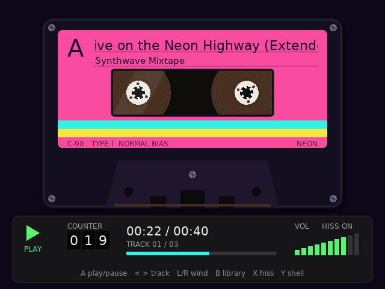

# Retro Cassette

A music player for [muOS](https://muos.dev) handhelds that looks like a cassette
tape. The reels spin while a track plays. Tape moves from the left reel to the
right one as the track goes on, and the nearly empty reel spins faster, like a
real cassette.


| Library | Neon shell |
| --- | --- |
|  |  |

Built with [LÖVE](https://love2d.org) 11.x (Lua).

## Features

- Folder browser over your music folders (MP3, OGG, FLAC, WAV)
- Plays the rest of the folder after the selected track
- Cassette deck with spinning reels, tape packs that follow progress, a tape counter and a volume meter
- Hold L/R to wind: the audio cuts out, the reels race and you hear the tape whir
- Optional tape hiss and a button "clunk" (both generated, no audio assets)
- Four shell styles: Classic, Chrome, Beach, Neon
- Remembers volume, hiss, shell style and the last folder
- Draws at 640×480 and scales with letterboxing, so 720×720 and 1024×768 screens work too

## Controls

| Button | Library | Cassette deck |
| --- | --- | --- |
| D-pad up/down | Move | Volume |
| D-pad left/right | Page up/down | Previous/next track |
| A | Open folder / play track | Play/pause |
| B | Parent folder | Back to library (music keeps playing) |
| X | | Tape hiss on/off |
| Y | Go to the deck | Next shell style |
| L1 / R1 (hold) | | Rewind / fast-forward |
| Select + Start, or Menu | Quit | Quit |

On a desktop: arrows, Z = A, X = B, C = X, V = Y, A/S = L1/R1, Tab = Select,
Space = Start, Esc = quit.

## Where to put music

The app looks for these folders and shows the ones that exist:

- `/mnt/sdcard/MUSIC`
- `/mnt/mmc/MUSIC`
- `/mnt/union/MUSIC`

Set `RC_MUSIC_DIR` to use a different folder.

## Install on a device

1. Build the package: `scripts/package.sh 0.1.0`. It writes `dist/RetroCassette-0.1.0.muxapp`.
2. Copy the `.muxapp` to the device's archive folder and install it from muOS's
   Archive Manager. Or copy the `RetroCassette` folder to
   `/mnt/mmc/MUOS/application/` yourself.
3. Start **Retro Cassette** from the Applications menu.

The app needs a LÖVE runtime. If your muOS build doesn't put `love` on `PATH`,
copy `love` and `libs.aarch64/` from a LÖVE app that ships with muOS into
`RetroCassette/bin/` before packaging (see [RetroCassette/bin/README.md](RetroCassette/bin/README.md)).
Output from the app goes to `RetroCassette/data/log.txt`, and settings are kept
in `RetroCassette/data/`.

> **Not yet tested on hardware.** The launcher, archive layout and button
> mapping follow what other muOS LÖVE apps do, but they still need to be checked on
> a real device. A/B can come out swapped depending on the device's controller
> mapping.

## Develop on a desktop

```sh
RC_MUSIC_DIR=~/Music love RetroCassette/game
```

Checks:

```sh
luajit tests/run.lua       # file listing, browser and player logic, LÖVE stubbed out
scripts/screenshots.sh     # runs the real app headless and saves screenshots (needs love, xvfb-run, python3)
```

## Layout

```
RetroCassette/            what gets installed on the device
  mux_launch.sh           muOS launcher (HELP / ICON / GRID headers)
  game/                   LÖVE project
    main.lua              screens and button handling
    lib/cassette.lua      cassette and deck drawing
    lib/player.lua        playback queue, winding
    lib/browser.lua       folder navigation
    lib/browser_view.lua  library screen drawing
    lib/fs.lua            SD card access (find / io.open)
    lib/input.lua         gamepad + keyboard to actions, key repeat
    lib/sfx.lua           generated hiss and clunk
    lib/settings.lua      settings file
    lib/scaler.lua        640x480 canvas scaled to the screen
scripts/                  package.sh, screenshots.sh
tests/run.lua             headless tests
tools/                    screenshot harness and test music generator
```

## Ideas for later

- Read ID3/Vorbis tags and cover art for the label
- Playlists, shuffle, resume where you left off
- A screen-off mode to save battery while listening
- Side B: flip the tape to play the folder in reverse
